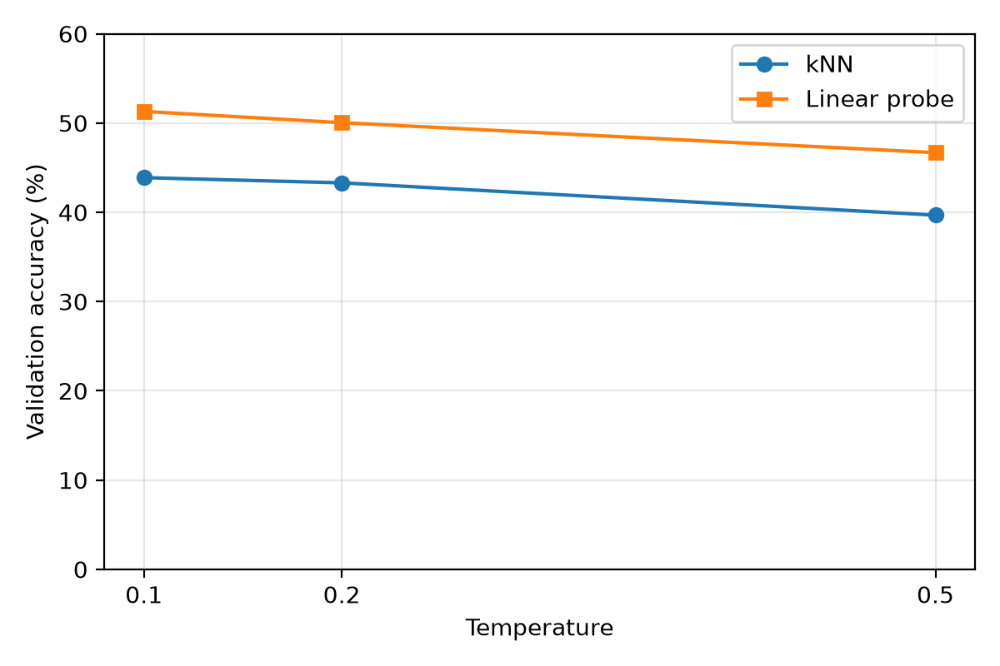
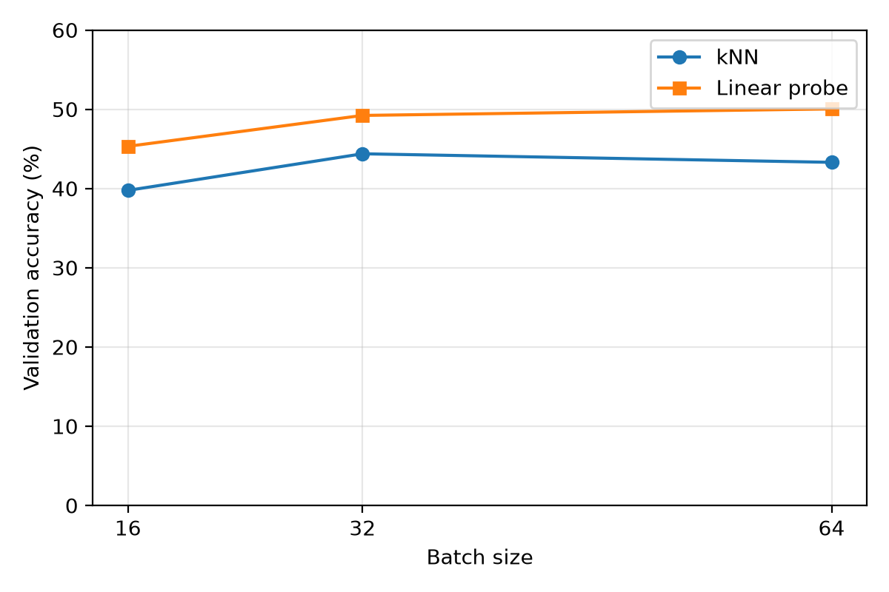

# Visual Embeddings: Contrastive Self-Supervised Learning

This work evaluates visual representations learned through SimCLR using ResNet-18 and InfoNCE on CIFAR-10. Temperature, batch size, and false-negative effects are examined using kNN and linear probing.

## Experimental Setup

Models were trained on 5,000 images for 8 epochs using AdamW, FP32, and a fixed seed (42). Accuracy was measured on 5,000 validation images.

## Results

### Temperature

| Temperature | kNN (%) | Linear Probe (%) |
|---|---:|---:|
| 0.1 | 43.88 | 51.30 |
| 0.2 | 43.30 | 50.04 |
| 0.5 | 39.68 | 46.68 |



### Batch Size

| Batch | kNN (%) | Linear Probe (%) |
|---|---:|---:|
| 16 | 39.76 | 45.32 |
| 32 | 44.38 | 49.22 |
| 64 | 43.30 | 50.04 |



### False-Negative Stress Test

| Condition | kNN (%) | Linear Probe (%) |
|---|---:|---:|
| Baseline | 43.30 | 50.04 |
| False negatives | 42.28 | 48.92 |

The stress test reduced kNN and linear probe accuracy by 1.02 and 1.12 percentage points, respectively. Results are based on one seed. Batch-size comparisons involve different numbers of optimizer updates, and the stress test also reduces batch diversity.

## Reproducibility

Create the environment using `environment.yml` and activate `visual-embeddings`.

```bash
python train.py --config config_small.yaml --name baseline_fp32 --epochs 8 --batch-size 64 --temperature 0.2
python evaluate.py --name baseline_fp32 --split val --probe-samples 5000
python plot_results.py
```
